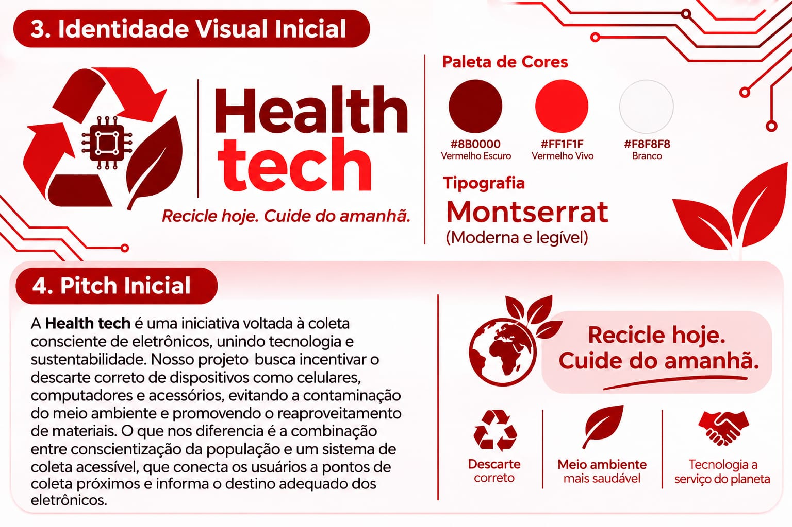

🌱 HealthTech — Tecnologia para um Futuro Sustentável

Descarte consciente, saúde protegida e tecnologia sustentável.

Instituição: Centro Universitário FMU
Curso: Gestão da Tecnologia da Informação
Projeto: HealthTech
Área: Tecnologia, Saúde, Sustentabilidade e Governança Verde
Ano: 2026

👥 Integrantes

Nome completo	Matrícula

Roger Luiz Ferreira de Souza	2026110111
Kawã Henrique Soares Silva	2026105520
Stephany Santos Pereira	3133363
Haru Akin Neres Alves	2026114560

🌍 1. Sobre o projeto

O HealthTech é uma proposta acadêmica que utiliza a tecnologia para promover a conscientização sobre o descarte adequado de resíduos eletrônicos.

O projeto busca contribuir para a preservação ambiental, a proteção da saúde humana e o desenvolvimento sustentável, seguindo os princípios da Governança Verde (Green IT).

⚠️ 2. Problema identificado

O descarte inadequado de equipamentos eletrônicos representa um desafio ambiental e social.

Celulares, computadores, baterias, carregadores e outros dispositivos podem conter substâncias prejudiciais ao meio ambiente e à saúde quando descartados incorretamente.

Além disso, parte da população encontra dificuldades para identificar locais apropriados para entregar esses materiais.

🎯 3. Público-alvo

O projeto é direcionado a:

* Estudantes e instituições de ensino.
* Famílias e consumidores de equipamentos eletrônicos.
* Comunidades interessadas em sustentabilidade.
* Pessoas que procuram informações sobre descarte responsável.
* Organizações que desejam incentivar práticas ambientais conscientes.

💡 4. Proposta de solução

Desenvolver uma plataforma digital informativa, acessível e intuitiva para orientar a população sobre o descarte correto de resíduos eletrônicos.

O protótipo inicial apresenta informações educativas e orientações práticas.

Como evolução futura, pretende-se implementar:

* Consulta a pontos de coleta.
* Pesquisa por localização.
* Informações sobre materiais aceitos.
* Organização de dados sobre locais de descarte.
* Recursos de gerenciamento de informações.
* Integração com fontes públicas, conforme disponibilidade e validação.

📊 5. Bases de dados públicas identificadas

SINIR — Sistema Nacional de Informações sobre a Gestão dos Resíduos Sólidos

Fonte oficial do Ministério do Meio Ambiente e Mudança do Clima.

Aplicação proposta: consultar informações sobre gestão de resíduos sólidos e apoiar a identificação de soluções ambientalmente adequadas.

SINIR — Logística reversa de eletroeletrônicos

Fonte de informações sobre o funcionamento dos sistemas de logística reversa de equipamentos eletrônicos.

Aplicação proposta: orientar a pesquisa sobre destinação e pontos de recebimento de resíduos eletrônicos.

SNIS — Sistema Nacional de Informações sobre Saneamento

Fonte pública de indicadores sobre saneamento e manejo de resíduos sólidos urbanos.

Aplicação proposta: fornecer informações para contextualizar os desafios relacionados à gestão de resíduos no Brasil.

Observação: essas fontes foram identificadas para consulta e possível utilização futura. O protótipo atual não realiza integração automática com bases de dados externas.

💻 6. Tecnologias utilizadas e previstas

HTML5 — Implementado

Utilizado na estruturação das páginas e na organização das informações.

Justificativa: permite desenvolver conteúdo web estruturado e acessível.

CSS3 — Implementado

Utilizado na identidade visual, nas cores, nos espaçamentos e na adaptação do layout.

Justificativa: proporciona uma apresentação organizada e melhora a experiência de navegação.

Java — Previsto para evolução

Tecnologia considerada para futuras funcionalidades de processamento e gerenciamento de informações.

Justificativa: possibilita desenvolver regras de negócio e aplicações de maior complexidade.

O arquivo Java presente no repositório representa uma etapa inicial de estudo e organização da proposta tecnológica.

🎨 7. Identidade visual

A identidade visual do HealthTech utiliza elementos associados à natureza, à inovação e à sustentabilidade.

Conceito do logotipo

O conceito visual combina referências à natureza e à tecnologia, representando a união entre inovação e responsabilidade ambiental.

O símbolo visual deverá ser consolidado como logotipo oficial do projeto.

Paleta de cores

Vermelho-escuro  #8B0000  Sustentabilidade e compromisso
Vermelho vivo    #FF1F1F  Tecnologia e inovação
Branco           #F8F8F8  Clareza e acessibilidade
Tipografia

Fonte principal: Montserrat, com fontes alternativas sem serifa.
Justificativa: proporcionar leitura simples, clara e acessível em diferentes dispositivos.

🚀 8. Pitch inicial

O futuro também depende de como descartamos.

O avanço tecnológico transforma a sociedade, mas também aumenta a necessidade de gerenciar corretamente os equipamentos eletrônicos que deixam de ser utilizados.

O HealthTech surge como uma proposta digital que conecta tecnologia, saúde e sustentabilidade, facilitando o acesso a informações sobre descarte responsável.

Seu diferencial está na abordagem educativa, na simplicidade de navegação e na proposta de futura integração de informações públicas para auxiliar os usuários na identificação de alternativas adequadas de descarte.

O objetivo é transformar informação em conscientização e incentivar pequenas atitudes capazes de contribuir para um futuro mais sustentável.

🌱 9. Green IT — Governança Verde

O projeto está alinhado aos princípios de Green IT, que incentivam a utilização responsável da tecnologia e a redução de impactos ambientais.

A proposta contribui para a educação ambiental e estimula práticas relacionadas ao consumo consciente, à reutilização, à reciclagem e à destinação adequada de equipamentos eletrônicos.

🌐 10. Protótipo desenvolvido

O protótipo inicial está publicado por meio do GitHub Pages.

Funcionalidades atuais:

* Página inicial informativa.
* Apresentação do problema ambiental.
* Orientações sobre descarte consciente.
* Conteúdo sobre sustentabilidade e Green IT.
* Navegação entre seções.
* Acesso à documentação do projeto.

Status: protótipo acadêmico inicial.

O site possui caráter educativo e não representa um serviço oficial de coleta de resíduos.

🔮 11. Próximas etapas

O desenvolvimento futuro poderá contemplar:

1. Levantamento e validação de pontos de coleta.
2. Organização de informações em uma base de dados.
3. Implementação de funcionalidades com Java.
4. Desenvolvimento de recursos de pesquisa.
5. Testes de acessibilidade e usabilidade.
6. Aprimoramento da interface.
7. Validação das informações com fontes oficiais.

📚 12. Referências

* Ministério do Meio Ambiente e Mudança do Clima — SINIR.
* SINIR — Logística Reversa de Eletroeletrônicos.
* Ministério das Cidades — SNIS.
* Política Nacional de Resíduos Sólidos — Lei nº 12.305/2010.

🎓 13. Considerações finais

O HealthTech demonstra como a Tecnologia da Informação pode contribuir para enfrentar desafios ambientais.

Por meio de uma plataforma digital educativa, o projeto pretende incentivar o descarte responsável de resíduos eletrônicos e ampliar a conscientização sobre sustentabilidade.

HealthTech — Conectando tecnologia, saúde e sustentabilidade. 🌱
